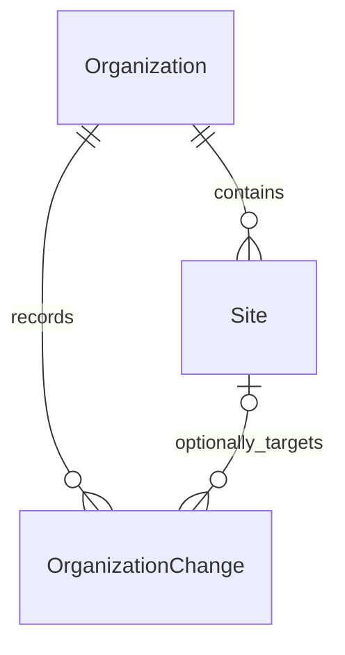

# Slice 01 physical model — increment 01.2

01.3 note: no model/schema/migration changes. Secured use cases own an operation transaction, lock the parent before loading/mutating the aggregate, compare the expected rowversion under that lock (including no-ops), and call an internal attributed-save path in the existing transaction. The public attributed SaveChanges still owns its transaction and rejects an external transaction. A fresh context/transaction is used per configured execution-strategy attempt; permissions and session identity are revalidated on each attempt. Commit acknowledgement failures return OutcomeUnknown without replay. The user subsequently reported the combined 01.3/affected-regression SQL run passed 12/12, zero failed/skipped, from normal Windows PowerShell. This is USER-EXECUTED evidence, not a new agent SQL run or production TLS validation. Overall Slice 01 remains incomplete pending real authentication and UI.

01.2 mapping/migration verified for their stated gates using agent offline checks and USER-EXECUTED SQL evidence; current receipts are in ForgeFlow.md. Separate 01.2 authorization covered the documented mappings and required minimum audit; Q1–Q3 alone did not authorize them in 01.1. Actual migration/model is `20261108124505_OrganizationSitesBaseline` with its snapshot under Infrastructure/Organizations/Migrations. Tables/constraints below remain the physical contract; generated SQL is evidence, not a competing source for hand edits. No future Item/BOM/Identity/membership tables are created by Slice 01.

01.2 supplies private persistence constructors/setters without public code/owner mutation. EF assigns identity/FK values, maps the Site owner field and the Organization collection field, and auto-includes the complete Site collection on organization queries. An offline EF materialization/fixup test passes; real SQL hydration remains unverified. UTC/actor metadata and rowversion are shadow properties, keeping SQL/EF dependencies out of Domain. Partial/projection aggregates cannot authorize lifecycle writes: the persistence save path also locks parents and queries current child state before committing.

## Routine mapping decisions and required audit boundary

FF-A005 requires atomic audit on the first business write; this increment therefore includes only the explicitly specified OrganizationChange table and its specialized writer. No configurable audit framework, viewer or security-event store. Business changes require `SaveChangesAsync(TrustedActor, CancellationToken)` after future secured use-case authorization; plain SaveChanges cannot perform unattributed writes. No actor provider or permission provider is registered. Audit attribution is not proof of authentication/authorization.

`AddOrganizationPersistence` registers a singleton `IDbContextFactory<OrganizationDbContext>`, removes the convenience circuit-scoped DbContext registration, and creates non-pooled contexts per operation. ConnectionStrings:ForgeFlow is required only when the factory is resolved; the accepted shell can start without a database setting. No startup migration, data seed, secret in source, sensitive logging or automatic write retry. Design-time scaffolding uses a non-routable placeholder, not a user database. The test harness alone creates randomly named disposable databases from an explicitly supplied test connection.

Business saves acquire UPDLOCK/HOLDLOCK on existing parent rows in ID order, validate effective parent/child status, stamp trusted UTC metadata and atomically flush business plus audit rows. They own the transaction and reject a pre-existing transaction; dispose context after failure. Database privileges below are encoded in a role with no user/login or membership assignment. Actual permission evaluation and provisioning remain AUTH-01/secured-use-case work. These SQL behaviors have generated/reviewed scripts but are not claimed verified until the blocked integration tests execute.

Site has exactly one Organization; an organization change targets either the organization (SiteId null) or one of its sites. These are three tables only: two business tables and the minimal atomic audit support table. Do not add country/address/contact/legal-entity hierarchies or unneeded navigations.

## Organization

| Column | SQL type | Null | Rule |
|---|---|---|---|
| Id | bigint IDENTITY(1,1) | No | PK; positive immutable surrogate |
| Code | varchar(32), Latin1_General_100_BIN2 | No | Canonical code; unique deployment-wide |
| Name | nvarchar(200) | No | Business display name; not automatically translated |
| IsActive | bit | No | Explicit create value true; no SQL default concealing omitted input |
| CreatedAtUtc | datetime2(7) | No | UTC instant from trusted clock |
| CreatedByActorId | bigint | No | Positive logical actor ID, no Identity FK |
| UpdatedAtUtc | datetime2(7) | Yes | Null until mutation; UTC |
| UpdatedByActorId | bigint | Yes | Null with UpdatedAtUtc; positive otherwise |
| RowVersion | rowversion | No | SQL-generated 8 bytes, not a timestamp/date |

Constraints: PK_Organization(Id), UX_Organization_Code(Code) on active and inactive records, IX_Organization_IsActive_Code(IsActive, Code, Id) for bounded listing. DB checks enforce canonical ASCII code grammar/length, nonblank trimmed Name, positive actor IDs, paired updated fields and UpdatedAtUtc >= CreatedAtUtc. Use binary-collation checks and DATALENGTH to reject trailing spaces, not SQL's space-padding equality semantics. Application validates the full Unicode-name/control-character policy; SQL enforces nonblank and length. Code/index behavior must be tested under the actual deployment collation. No user-supplied SQL collation expression or culture-dependent normalization.

Implementation detail: SQL Name trimming checks ASCII surrounding spaces; Domain applies the full documented Unicode trim/control policy. Code is canonical before SQL parameters are constructed. SQL checks constrain the stored varchar value; they cannot detect characters already changed by a client/SQL best-fit conversion before storage. The Domain rejects non-ASCII input before that boundary. There is no database default for active status; false is explicitly persisted. No unique index filters exclude inactive records.

## Site

| Column | SQL type | Null | Rule |
|---|---|---|---|
| Id | bigint IDENTITY(1,1) | No | PK; positive immutable surrogate |
| OrganizationId | bigint | No | FK Organization(Id), immutable |
| Code | varchar(32), Latin1_General_100_BIN2 | No | Canonical code, unique within organization |
| Name | nvarchar(200) | No | Same name policy as Organization |
| IsActive | bit | No | Explicit create value true |
| CreatedAtUtc | datetime2(7) | No | UTC |
| CreatedByActorId | bigint | No | Positive logical actor |
| UpdatedAtUtc | datetime2(7) | Yes | Paired with updated actor |
| UpdatedByActorId | bigint | Yes | Positive when present |
| RowVersion | rowversion | No | SQL-generated concurrency token |

Constraints: PK_Site(Id), AK_Site_Organization_Id(OrganizationId, Id), UX_Site_Organization_Code(OrganizationId, Code), IX_Site_Organization_IsActive_Code(OrganizationId, IsActive, Code, Id). Same field checks as Organization. FK_Site_Organization is NO ACTION on delete/update. Composite candidate key is required for scope-safe site references even though Id is globally unique. No FK or check constraint alone proves parent active: Application transaction protocol in README owns that cross-row invariant. All writes use that protocol; direct business-table writes outside the application are not supported operations.

## OrganizationChange — append-only audit

| Column | SQL type | Null | Rule |
|---|---|---|---|
| Id | bigint IDENTITY(1,1) | No | PK |
| OrganizationId | bigint | No | FK Organization(Id) |
| SiteId | bigint | Yes | Composite FK (OrganizationId, SiteId) -> Site(OrganizationId, Id) when present |
| ActorId | bigint | No | Positive authenticated/bootstrap actor; no future Identity table |
| EventCode | varchar(64) | No | One of the eight event names in README |
| OccurredAtUtc | datetime2(7) | No | UTC trusted clock instant |
| CorrelationId | uniqueidentifier | No | Trace correlation, not authorization/idempotency token |
| ChangesJson | nvarchar(2000) | No | Valid JSON of allowlisted before/after Code, Name, IsActive only |

PK_OrganizationChange(Id); IX_OrganizationChange_Organization_Time(OrganizationId, OccurredAtUtc, Id); IX_OrganizationChange_Site_Time(OrganizationId, SiteId, OccurredAtUtc, Id). FKs NO ACTION; CHECK positive ActorId, ISJSON(ChangesJson)=1, finite EventCode set and SiteId null iff the event is an Organization event. Organization create records use the newly allocated OrganizationId in the same transaction; no audit before the principal row exists. JSON structure/allowlist is validated by the writer, not inferred from ISJSON. Organization scope, actor, event and correlation must come from trusted command handling; never serialize arbitrary DTOs. Success is implicit because this table records committed changes only. Rowversion is unnecessary for append-only rows.

Created/updated actor columns are attributable metadata, not substitutes for this history. No FK to a speculative user table; AUTH-01 must ensure immutable actor IDs and valid actor resolution. App SQL principal gets only the minimum grants: SELECT/INSERT/UPDATE on Organization/Site (no DELETE); SELECT/INSERT on OrganizationChange (no UPDATE/DELETE). Migration administration uses a separate identity. Integration tests must prove those denials. Do not imply that the DB administrator is prevented from altering records.

Migration creates the database role `ForgeFlowOrganizationRuntime`, grants only the listed object permissions and explicitly denies the prohibited writes. No existing user is altered or added to it. Deployment must map a separate runtime principal to that role; running as db_owner would not prove these restrictions. Audit event validation uses binary comparison and rejects trailing ASCII padding. JSON is constructed solely from the allowed Code/Name/IsActive fields; Unicode-preserving JSON encoding avoids overflowing nvarchar(2000) on valid 200-character Persian before/after names. Stored JSON must be rendered safely by any future viewer, never injected as HTML.

## Mutation and storage rules

Only UTC instants are persisted here; no date-only/calendar fields or timezone column are required. Application uses UTC DateTime/DateTimeOffset conversions consistently; datetime2 itself cannot enforce a timezone. Server clock supplies timestamps, not browser fields. If a clock regresses below CreatedAtUtc, fail the mutation rather than falsify its chronology. SQL rowversion is the authority for concurrency; client timestamps are not compared for conflicts.

EF mapping must declare concurrency tokens and send the expected rowversion in the update predicate; an affected-row count of zero is a conflict after authorized existence is checked. Code/owner immutability is enforced by the Domain/Application commands, with no command accepting replacements. All FKs restrict deletion, no cascades or soft-delete columns. IsActive expresses lifecycle, not hidden deletion.

For future modules only, ownership matrix reference rules require composite owner/FKs. This ERD intentionally contains no placeholder master tables. Site/organization ID mismatches are rejected by scoped queries and the composite FK on audit now; future module FKs must carry the same owner proof.

Before first migration, inventory the actual target schema/migration history. Fresh disposable DB: reproduce create/update and a documented rollback. Existing DB: stop for a reconciliation plan; never pretend a generated script proves compatibility. Rollback must preserve committed organization/site/audit data (restore verified backup or forward correction); dropping populated tables is not a supported automatic downgrade. Acceptance requires real SQL integration with the intended provider; EF InMemory and generated DDL alone cannot close the gate.

The generated Down migration refuses non-empty Organization/Site/OrganizationChange tables before dropping anything. Its empty-database rollback/reapply scenario is in the disposable SQL harness but was skipped here. A populated deployment requires reviewed backup/forward recovery; this increment does not authorize touching an existing database.
