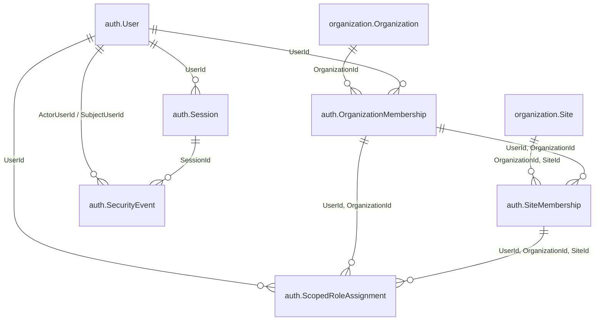

# Slice 02 physical ERD (`02-users-memberships`)

## Existing tables verified in `AuthDbContext` (`src/ForgeFlow.Infrastructure/Identity/AuthDbContext.cs`)

Slice 02 builds directly on the existing `auth` and `organization` schema without creating speculative shadow tables. Any optional column addition depends solely on approved answers in [decisions.md](decisions.md) (`Q-U01` `MustChangePassword`, `Q-U04` `DisplayName`).

### 1. `auth.User` (`ApplicationAccount : IdentityUser<long>`)
- **Primary key**: `Id` (`bigint IDENTITY`).
- **Key columns**:
  - `UserName` (`nvarchar(128) NOT NULL`), immutable (`AuthDbContext.Guard()`).
  - `NormalizedUserName` (`nvarchar(128) COLLATE Latin1_General_100_BIN2 NOT NULL`), unique index `UX_User_NormalizedUserName`.
  - `IsActive` (`bit NOT NULL`, default `1`).
  - `PreferredCulture` (`varchar(5) NULL`, `'fa-IR'` or `'en-US'`).
  - `PasswordHash` (`nvarchar(max) NOT NULL`), `SecurityStamp` (`nvarchar(256) NOT NULL`), `ConcurrencyStamp` (`nvarchar(256) NOT NULL`, concurrency token).
  - `LockoutEnd` (`datetimeoffset(7) NULL`), `AccessFailedCount` (`int NOT NULL`).
  - `CreatedAtUtc` (`datetime2(7) NOT NULL`), `UpdatedAtUtc` (`datetime2(7) NULL`), `RowVersion` (`rowversion NOT NULL`).
- **Existing SQL checks**:
  - `CK_User_Name`: length 1..128 chars, ASCII only (`[A-Za-z0-9._@+-]`), `NormalizedUserName = UPPER(UserName)`.
  - `CK_User_Culture`: `NULL` or exact `'fa-IR'`/`'en-US'`.
  - `CK_User_Metadata`: `AccessFailedCount >= 0`, `UpdatedAtUtc >= CreatedAtUtc`, `DATEPART(TZOFFSET, LockoutEnd) = 0`.
- **Potential decision-dependent additions**:
  - If `Q-U01` adopts first-login password change: `MustChangePassword bit NOT NULL DEFAULT 0`.
  - If `Q-U04` adopts profile display name: `DisplayName nvarchar(200) NULL` (checked against control characters / blank string).

### 2. `auth.OrganizationMembership`
- **Primary key**: `(UserId, OrganizationId)`.
- **FKs (`DeleteBehavior.NoAction`)**:
  - `UserId -> auth.User(Id)`
  - `OrganizationId -> organization.Organization(Id)`
- **Columns**: `IsActive` (`bit NOT NULL`), `CreatedAtUtc` (`datetime2(7)`), `CreatedByActorId` (`bigint`), `UpdatedAtUtc` (`datetime2(7) NULL`), `UpdatedByActorId` (`bigint NULL`), `RowVersion` (`rowversion NOT NULL`).
- **Index**: `(OrganizationId, IsActive, UserId)`.
- **Check**: `CK_OrganizationMembership_Metadata` (`CreatedByActorId > 0`, paired `UpdatedAtUtc`/`UpdatedByActorId`).

### 3. `auth.SiteMembership`
- **Primary key**: `(UserId, OrganizationId, SiteId)`.
- **Composite FKs (`DeleteBehavior.NoAction`)**:
  - `(UserId, OrganizationId) -> auth.OrganizationMembership(UserId, OrganizationId)`
  - `(OrganizationId, SiteId) -> organization.Site(OrganizationId, Id)`
- **Columns & metadata**: `IsActive`, `CreatedAtUtc`, `CreatedByActorId`, `UpdatedAtUtc`, `UpdatedByActorId`, `RowVersion`, `CK_SiteMembership_Metadata`.
- **Index**: `(OrganizationId, SiteId, IsActive, UserId)`.

### 4. `auth.ScopedRoleAssignment` *(in scope if `Q-U02` Option A approved; read-only invariant check for `Q-U05` either way)*
- **Key**: `Id` (`bigint IDENTITY`), `UserId`, `RoleId` (`1`=OrgAdmin, `2`=SiteOperator, `3`=DeploymentProvisioner), `ScopeKind` (`0`=Platform, `1`=Organization, `2`=Site), `OrganizationId`, `SiteId`, `IsActive`, metadata + `RowVersion`.
- **Check**: `CK_Role_Scope` binds `(RoleId, ScopeKind, OrganizationId, SiteId)` strictly. Immutable scope columns via `AuthDbContext.Guard()`.
- **Filtered unique indexes**: Prevent duplicate assignments for `(UserId, RoleId)` at Platform, `(UserId, RoleId, OrganizationId)` at Organization, and `(UserId, RoleId, OrganizationId, SiteId)` at Site.

### 5. `auth.Session` (`AccountSession`)
- **Primary key**: `Id` (`uniqueidentifier`).
- **Lifecycle constraint `CK_Session_Lifecycle`**: `RevokeReason IN ('Logout', 'PasswordReset', 'AccountDisabled', 'AccountLocked', 'StampChanged')`.
- **Slice 02 usage**: Deactivating `ApplicationAccount.IsActive` bulk-updates all open sessions (`RevokedAtUtc IS NULL`) for `UserId` with `RevokeReason = 'AccountDisabled'` and `RevokedAtUtc = nowUtc` inside the same transaction while rotating `SecurityStamp`.

### 6. `auth.SecurityEvent` (`SecurityEvent`)
- **Primary key**: `Id` (`bigint IDENTITY`), append-only (`AuthDbContext.Guard()` forbids UPDATE/DELETE).
- **Allowlisted codes already present in `CK_SecurityEvent_Code`**:
  - `'AccountCreated'`
  - `'AccountEligibilityChanged'`
  - `'MembershipChanged'`
  - `'ScopedRoleChanged'` *(if `Q-U02` Option A)*
  - `'SessionRevoked'`
  - `'AccessDenied'`

## Migration & rollback discipline

- **Zero EF migration in Slice 02 (confirmed by `02.0` decisions `Q-U01` / `Q-U04`)**: Neither `MustChangePassword` nor `DisplayName` is added to `auth.User`; Slice 02 operates cleanly on the already-verified `AUTH-01` and Slice 01 tables, indexes, composite FKs, and check constraints (`CK_Session_Lifecycle` `'AccountDisabled'`, `CK_SecurityEvent_Code` `'AccountCreated'`, `'AccountEligibilityChanged'`, `'MembershipChanged'`, `'ScopedRoleChanged'`, `'SessionRevoked'`).
- **Rollback**: Because no DDL migration is required, code changes stay non-destructive to existing rows (`BootstrapState`, `User`, `OrganizationMembership`, `SiteMembership` in `localhost/testforgflow`).
- **Locking protocol on writes**:
  1. Acquire `UPDLOCK, HOLDLOCK` on `organization.Organization` row (when checking active org or last-active-admin invariant).
  2. Acquire `UPDLOCK, HOLDLOCK` on `auth.User` row (matches `RuntimeSessions` login & `HostRecovery` lock ordering).
  3. Perform mutations + `SecurityEvent` insert + `AccountSession` revocation atomically; never hold locks across external calls.
