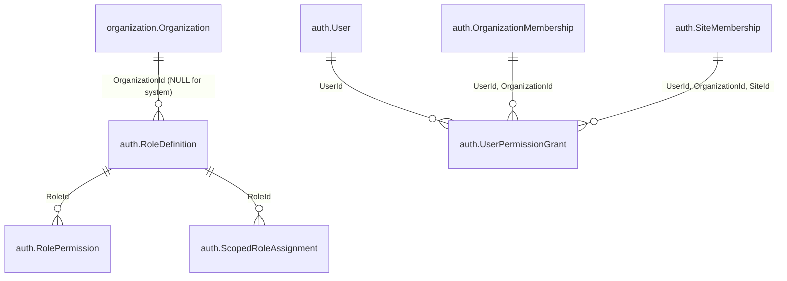

# Slice 03 physical ERD (`03-roles-permissions`)

## Proposed schema evolution on `auth` (`AuthDbContext`)

Builds non-destructively atop `auth.User`, `auth.OrganizationMembership`, `auth.SiteMembership`, `auth.ScopedRoleAssignment`, `auth.SecurityEvent`, `organization.Organization`, and `organization.Site`.

### 1. New table: `auth.RoleDefinition`
- **PK**: `Id` (`bigint IDENTITY(100, 1)` — system roles `1, 2, 3` inserted explicitly in migration).
- **Columns**:
  - `Code` (`varchar(64) NOT NULL` for system roles or generated/ASCII code; OR `Name` `nvarchar(100) NOT NULL`)
  - `Name` (`nvarchar(100) NOT NULL`), `NormalizedName` (`nvarchar(100) COLLATE Latin1_General_100_BIN2 NOT NULL`)
  - `IsSystem` (`bit NOT NULL`)
  - `ScopeKind` (`tinyint NOT NULL`: `0 = Platform` [system only], `1 = Organization`, `2 = Site`)
  - `OrganizationId` (`bigint NULL`, FK -> `organization.Organization(Id)`)
  - `IsActive` (`bit NOT NULL`, default `1`)
  - Shadow audit metadata: `CreatedAtUtc`, `CreatedByActorId` (`0` allowed only for system seed `IsSystem = 1`, `> 0` for all tenant roles), `UpdatedAtUtc`, `UpdatedByActorId`, `RowVersion`.
- **Unique index**: `(OrganizationId, NormalizedName)` where `IsSystem = 0` (`UX_RoleDefinition_Org_Name`); unique system `Code` where `IsSystem = 1`.
- **Check constraint**: `([IsSystem]=1 AND [OrganizationId] IS NULL) OR ([IsSystem]=0 AND [OrganizationId] IS NOT NULL AND [ScopeKind] IN (1, 2))`.

### 2. New table: `auth.RolePermission`
- **PK**: `(RoleId, PermissionCode)`.
- **FK**: `RoleId -> auth.RoleDefinition(Id)` (`DeleteBehavior.NoAction`).
- **Columns**: `RoleId` (`bigint`), `PermissionCode` (`varchar(64) NOT NULL`), `IsActive` (`bit NOT NULL`), metadata (`CreatedAtUtc`, `CreatedByActorId`, `UpdatedAtUtc`, `UpdatedByActorId`, `RowVersion`).
- **Index**: `(PermissionCode, IsActive, RoleId)`.
- **Check**: `PermissionCode` ASCII-only non-empty matching allowlisted known permissions.

### 3. Existing table updated non-destructively: `auth.ScopedRoleAssignment`
- `RoleId` widens from `tinyint` (`1..3`) OR stays `bigint`?
  - Note for migration safety: altering `RoleId` from `tinyint` (`byte`) to `bigint` (`long`) requires dropping/recreating `CK_Role_Scope` and the filtered unique indexes on `RoleId`, OR keeping `RoleId` `int`/`bigint` cleanly!
  - Let's verify all existing rows (`1, 2, 3`) convert cleanly `tinyint -> bigint` with zero data loss and recreate:
    - `FK_ScopedRoleAssignment_RoleDefinition(RoleId) -> auth.RoleDefinition(Id)`
    - Structural `CK_Role_Scope`: `([ScopeKind]=0 AND [OrganizationId] IS NULL AND [SiteId] IS NULL) OR ([ScopeKind]=1 AND [OrganizationId] IS NOT NULL AND [SiteId] IS NULL) OR ([ScopeKind]=2 AND [OrganizationId] IS NOT NULL AND [SiteId] IS NOT NULL)`
    - Filtered unique indexes `(UserId, RoleId)` (`ScopeKind=0`), `(UserId, RoleId, OrganizationId)` (`ScopeKind=1`), `(UserId, RoleId, OrganizationId, SiteId)` (`ScopeKind=2`).
    - Composite tenant-ownership guard: application use case validates `role.OrganizationId is null || role.OrganizationId == request.OrganizationId` AND `role.ScopeKind == request.ScopeKind`! (Even better: optional `RoleOrganizationId` or check trigger/app guard + filtered FK!)

### 4. New table *(if `Q-R01` Option A or C approved)*: `auth.UserPermissionGrant`
- **PK**: `Id` (`bigint IDENTITY`).
- **Columns**:
  - `UserId` (`bigint NOT NULL`), `ScopeKind` (`tinyint NOT NULL`: `1 = Organization`, `2 = Site` — Platform direct grants disallowed)
  - `OrganizationId` (`bigint NOT NULL`), `SiteId` (`bigint NULL`)
  - `PermissionCode` (`varchar(64) NOT NULL`), `IsActive` (`bit NOT NULL`)
  - Audit metadata + `RowVersion`.
- **Composite FKs (`DeleteBehavior.NoAction`)**:
  - `(UserId, OrganizationId) -> auth.OrganizationMembership(UserId, OrganizationId)`
  - `(UserId, OrganizationId, SiteId) -> auth.SiteMembership(UserId, OrganizationId, SiteId)`
- **Unique filtered indexes**:
  - `(UserId, OrganizationId, PermissionCode)` where `ScopeKind = 1`
  - `(UserId, OrganizationId, SiteId, PermissionCode)` where `ScopeKind = 2`
- **Guard**: `AuthDbContext.Guard()` makes `RoleDefinition.IsSystem`, `RolePermission` keys, and `UserPermissionGrant` target scope keys immutable (`Auth.ImmutableHistory`).

### 5. `auth.SecurityEvent`
- Additive constraint replacement on `CK_SecurityEvent_Code` adding `'RoleDefinitionChanged'` and `'DirectPermissionChanged'` alongside all existing codes (`BootstrapCompleted`, `AccountCreated`, `SignInFailed`, `AccountLocked`, `SessionIssued`, `SessionRevoked`, `AccessDenied`, `PasswordResetCompleted`, `AccountEligibilityChanged`, `MembershipChanged`, `ScopedRoleChanged`, `CulturePreferenceChanged`).

## Transition & rollback discipline

- **Existing DB compatibility (`localhost/testforgflow`)**: Migration preserves every existing row, backfills system definitions `1..3` safely before applying FK constraints, and leaves `Organization` schema completely untouched.
- **Disposable SQL upgrade test**: Test suite explicitly applies the prior baseline migration, runs `HostBootstrapper` (so `ScopedRoleAssignment` `RoleId = 1` exists), then runs `MigrateAsync()` to Slice 03 and verifies zero lost data and working authorization!
