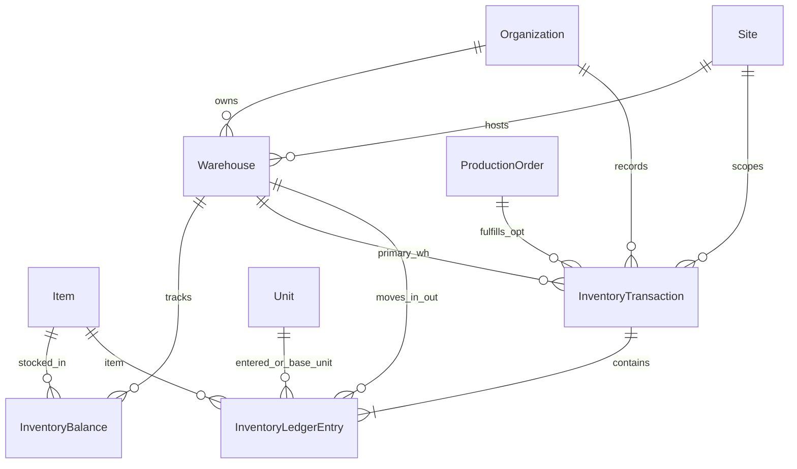

# Slice 07 Physical ERD (`[organization].[Warehouse]`, `InventoryTransaction`, `InventoryLedgerEntry`, `InventoryBalance`)

## 1. Schema & Ownership
All new tables live in schema `[organization]` and carry composite `(OrganizationId, ...)` foreign keys referencing `[organization].[Organization]`, `[organization].[Site]`, `[organization].[Item]`, `[organization].[Unit]`, and optionally `[organization].[ProductionOrder]`.

## 2. Tables & Constraints

### `[organization].[Warehouse]`
- Columns: `Id (bigint PK IDENTITY)`, `OrganizationId (bigint)`, `SiteId (bigint)`, `Code (varchar(32) BIN2)`, `Name (nvarchar(200))`, `IsDefaultForSite (bit)`, `IsActive (bit)`, audit metadata (`CreatedAtUtc`, `CreatedByActorId`, `RowVersion`, `UpdatedAtUtc`, `UpdatedByActorId`).
- Keys & Indexes:
  - `AK_Warehouse_Org_Id`: `(OrganizationId, Id)`
  - `UX_Warehouse_Org_Code`: unique `(OrganizationId, Code)`
  - Filtered unique index `UX_Warehouse_Org_Site_Default`: unique `(OrganizationId, SiteId)` `WHERE [IsDefaultForSite] = 1 AND [IsActive] = 1`
- Foreign keys (`NO ACTION`):
  - `(OrganizationId)` -> `Organization(Id)`
  - `(OrganizationId, SiteId)` -> `Site(OrganizationId, Id)`

### `[organization].[InventoryTransaction]`
- Columns: `Id (bigint PK IDENTITY)`, `OrganizationId (bigint)`, `SiteId (bigint)`, `WarehouseId (bigint)`, `DestinationWarehouseId (bigint NULL)`, `DocumentNumber (varchar(32) BIN2)`, `TransactionType (tinyint)` (`1..8`), `ProductionOrderId (bigint NULL)`, `ReversedTransactionId (bigint NULL)`, `ReferenceNote (nvarchar(500) NULL)`, `IdempotencyKey (varchar(64) NULL BIN2)`, `PostedAtUtc (datetime2(7))`, audit metadata.
- Keys & Constraints:
  - `AK_InventoryTransaction_Org_Id`: `(OrganizationId, Id)`
  - `UX_InventoryTransaction_Org_DocNum`: unique `(OrganizationId, DocumentNumber)`
  - Filtered unique index `UX_InventoryTransaction_Org_Idempotency`: unique `(OrganizationId, IdempotencyKey)` `WHERE [IdempotencyKey] IS NOT NULL`
  - `CK_InventoryTransaction_Type`: `[TransactionType] BETWEEN 1 AND 8`
  - FKs (`NO ACTION`): `(OrganizationId)` -> `Organization`, `(OrganizationId, SiteId)` -> `Site`, `(OrganizationId, WarehouseId)` -> `Warehouse`, `(OrganizationId, DestinationWarehouseId)` -> `Warehouse`, `(OrganizationId, ProductionOrderId)` -> `ProductionOrder`, `(OrganizationId, ReversedTransactionId)` -> `InventoryTransaction`.

### `[organization].[InventoryLedgerEntry]` (Append-Only)
- Columns: `Id (bigint PK IDENTITY)`, `OrganizationId (bigint)`, `InventoryTransactionId (bigint)`, `SiteId (bigint)`, `WarehouseId (bigint)`, `LineNumber (int)`, `ItemId (bigint)`, `LotCode (varchar(32) BIN2 NOT NULL DEFAULT '')`, `EnteredQuantity (decimal(18,6))` (`!= 0`), `EnteredUnitId (bigint)`, `BaseQuantityDelta (decimal(18,6))` (`!= 0`), `BaseUnitId (bigint)`, `OccurredAtUtc (datetime2(7))`, `Notes (nvarchar(300) NULL)`, audit metadata.
- Constraints & Indexes:
  - `CK_InventoryLedgerEntry_Qty`: `[EnteredQuantity] <> 0 AND [BaseQuantityDelta] <> 0`
  - `IX_InventoryLedgerEntry_Org_Wh_Item_Lot`: `(OrganizationId, WarehouseId, ItemId, LotCode, OccurredAtUtc DESC)`
  - `IX_InventoryLedgerEntry_Org_Txn`: `(OrganizationId, InventoryTransactionId, LineNumber)`
  - FKs (`NO ACTION`): `(OrganizationId, InventoryTransactionId)` -> `InventoryTransaction`, `(OrganizationId, WarehouseId)` -> `Warehouse`, `(OrganizationId, SiteId)` -> `Site`, `(OrganizationId, ItemId)` -> `Item`, `(OrganizationId, EnteredUnitId)` -> `Unit`, `(OrganizationId, BaseUnitId)` -> `Unit`.

### `[organization].[InventoryBalance]`
- Columns: `Id (bigint PK IDENTITY)`, `OrganizationId (bigint)`, `SiteId (bigint)`, `WarehouseId (bigint)`, `ItemId (bigint)`, `LotCode (varchar(32) BIN2 NOT NULL DEFAULT '')`, `BaseUnitId (bigint)`, `OnHandBaseQuantity (decimal(18,6))`, `LastMovedAtUtc (datetime2(7))`, audit metadata + `RowVersion`.
- Constraints & Indexes:
  - `UX_InventoryBalance_Org_Wh_Item_Lot`: unique `(OrganizationId, WarehouseId, ItemId, LotCode)`
  - `CK_InventoryBalance_NonNegative`: `[OnHandBaseQuantity] >= 0`
  - FKs (`NO ACTION`): `(OrganizationId, SiteId)` -> `Site`, `(OrganizationId, WarehouseId)` -> `Warehouse`, `(OrganizationId, ItemId)` -> `Item`, `(OrganizationId, BaseUnitId)` -> `Unit`.

## 3. Runtime Security & Audit Contract
- `[ForgeFlowOrganizationRuntime]`:
  - `GRANT SELECT, INSERT, UPDATE` + `DENY DELETE` on `Warehouse` and `InventoryBalance`.
  - `GRANT SELECT, INSERT` + `DENY UPDATE, DELETE` on `InventoryTransaction` and `InventoryLedgerEntry` (strictly append-only movement ledger!).
- `OrganizationChange` Site-scoped events (`SiteId IS NOT NULL`):
  - `Warehouse.Created`, `Warehouse.Updated`, `Warehouse.Activated`, `Warehouse.Deactivated`
  - `InventoryTransaction.Posted`, `InventoryTransaction.Reversed`
