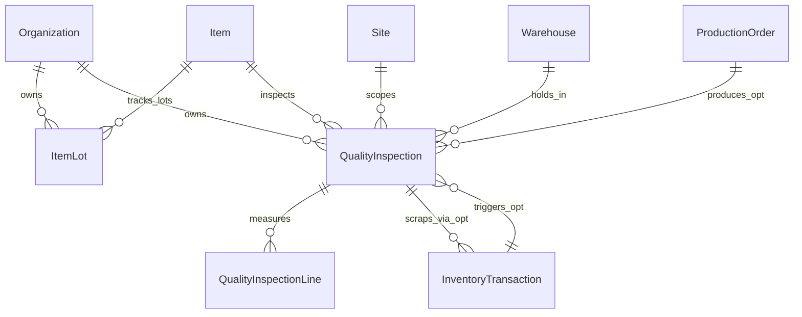

# Slice 09 Physical ERD (`09-quality-traceability`)

## 1. Schema & Ownership
All additions live in schema `[organization]` and preserve composite `(OrganizationId, ...)` foreign keys and `NO ACTION` delete behavior.

## 2. Additive Changes to Existing Tables

### `[organization].[Item]`
- `RequiresLotTracking` (`bit NOT NULL DEFAULT 0`)
- `QualityControlMode` (`tinyint NOT NULL DEFAULT 0`, `CONSTRAINT [CK_Item_QualityControlMode] CHECK ([QualityControlMode] BETWEEN 0 AND 3)`)

### `[organization].[InventoryBalance]`
- `BlockedBaseQuantity` (`decimal(18,6) NOT NULL DEFAULT 0`)
- `CONSTRAINT [CK_InventoryBalance_Blocked] CHECK ([BlockedBaseQuantity] >= 0 AND [BlockedBaseQuantity] <= [OnHandBaseQuantity])`

### `[organization].[InventoryTransaction]`
- Update `CK_InventoryTransaction_Type`: `[TransactionType] BETWEEN 1 AND 9` (`9 = QualityScrap`)
- Add nullable `QualityInspectionId` (`bigint NULL`)
- Composite FK (`NO ACTION`): `(OrganizationId, QualityInspectionId)` -> `[organization].[QualityInspection] ([OrganizationId], [Id])`

## 3. New Tables

### `[organization].[ItemLot]`
- Columns: `Id (bigint PK IDENTITY)`, `OrganizationId (bigint)`, `ItemId (bigint)`, `LotCode (varchar(32) BIN2)`, `ManufactureDate (date NULL)`, `ExpirationDate (date NULL)`, `Notes (nvarchar(500) NULL)`, audit metadata (`CreatedAtUtc`, `CreatedByActorId`, `RowVersion`, `UpdatedAtUtc`, `UpdatedByActorId`).
- Keys & Indexes:
  - `UX_ItemLot_Org_Item_Lot`: unique `(OrganizationId, ItemId, LotCode)`
  - `IX_ItemLot_Org_Expiration`: `(OrganizationId, ExpirationDate)`
  - `CK_ItemLot_Code`: `LEN([LotCode]) > 0 AND DATALENGTH([LotCode]) = LEN([LotCode])`
  - `CK_ItemLot_Dates`: `[ManufactureDate] IS NULL OR [ExpirationDate] IS NULL OR [ExpirationDate] >= [ManufactureDate]`
- FKs (`NO ACTION`): `(OrganizationId)` -> `Organization`, `(OrganizationId, ItemId)` -> `Item`.

### `[organization].[QualityInspection]`
- Columns: `Id (bigint PK IDENTITY)`, `OrganizationId (bigint)`, `SiteId (bigint)`, `WarehouseId (bigint)`, `ItemId (bigint)`, `LotCode (varchar(32) BIN2 NOT NULL DEFAULT '')`, `InspectionNumber (varchar(32) BIN2)`, `SourceType (tinyint)` (`1=Receipt`, `2=ProductionReceipt`, `3=ManualHold`), `SourceTransactionId (bigint NULL)`, `ProductionOrderId (bigint NULL)`, `BaseUnitId (bigint)`, `InspectedBaseQuantity (decimal(18,6))`, `AcceptedBaseQuantity (decimal(18,6))`, `RejectedBaseQuantity (decimal(18,6))`, `RemainingBlockedBaseQuantity (decimal(18,6))`, `Status (tinyint)` (`1=Pending`, `2=InReview`, `3=Completed`, `4=Cancelled`), `DefectReasonCode (varchar(64) BIN2 NULL)`, `Notes (nvarchar(1000) NULL)`, `InspectedAtUtc (datetime2(7) NULL)`, `InspectedByActorId (bigint NULL)`, audit metadata + `RowVersion`.
- Constraints & Indexes:
  - `AK_QualityInspection_Org_Id`: `(OrganizationId, Id)`
  - `UX_QualityInspection_Org_Number`: unique `(OrganizationId, InspectionNumber)`
  - `IX_QualityInspection_Org_Site_Status`: `(OrganizationId, SiteId, Status, Id DESC)`
  - `IX_QualityInspection_Org_Item_Lot`: `(OrganizationId, ItemId, LotCode)`
  - `CK_QualityInspection_Status`: `[Status] BETWEEN 1 AND 4`
  - `CK_QualityInspection_SourceType`: `[SourceType] BETWEEN 1 AND 3`
  - `CK_QualityInspection_Quantities`: `[InspectedBaseQuantity] > 0 AND [AcceptedBaseQuantity] >= 0 AND [RejectedBaseQuantity] >= 0 AND [RemainingBlockedBaseQuantity] >= 0 AND ([AcceptedBaseQuantity] + [RejectedBaseQuantity] + [RemainingBlockedBaseQuantity]) <= [InspectedBaseQuantity]`
- FKs (`NO ACTION`): `(OrganizationId)` -> `Organization`, `(OrganizationId, SiteId)` -> `Site`, `(OrganizationId, WarehouseId)` -> `Warehouse`, `(OrganizationId, ItemId)` -> `Item`, `(OrganizationId, BaseUnitId)` -> `Unit`, `(OrganizationId, SourceTransactionId)` -> `InventoryTransaction`, `(OrganizationId, ProductionOrderId)` -> `ProductionOrder`.

### `[organization].[QualityInspectionLine]`
- Columns: `Id (bigint PK IDENTITY)`, `OrganizationId (bigint)`, `QualityInspectionId (bigint)`, `LineNumber (int)`, `ParameterName (nvarchar(100))`, `ExpectedSpec (nvarchar(100) NULL)`, `MeasuredValue (nvarchar(100) NULL)`, `IsPassed (bit)`, `Notes (nvarchar(300) NULL)`.
- Constraints & Indexes:
  - `UX_QualityInspectionLine_Org_Insp_Line`: unique `(OrganizationId, QualityInspectionId, LineNumber)`
  - `CK_QualityInspectionLine_LineNum`: `[LineNumber] > 0`
- FKs (`NO ACTION`): `(OrganizationId, QualityInspectionId)` -> `QualityInspection` (`ON DELETE NO ACTION`).

## 4. Runtime Security & Audit Contract
- `[ForgeFlowOrganizationRuntime]`:
  - `GRANT SELECT, INSERT, UPDATE` + `DENY DELETE` on `ItemLot` and `QualityInspection`.
  - `GRANT SELECT, INSERT, UPDATE, DELETE` (or `SELECT, INSERT, UPDATE` + replace via explicit line management) on `QualityInspectionLine` — wait: prefer `GRANT SELECT, INSERT, UPDATE, DELETE` on child `QualityInspectionLine` only while `QualityInspection` is `Pending`/`InReview`, OR `DENY DELETE` on `QualityInspection` header and `ItemLot`!
- `OrganizationChange` Site-scoped / Org-scoped events:
  - `QualityInspection.Created`, `QualityInspection.Updated`, `QualityInspection.Disposed`, `QualityInspection.Cancelled`
  - `ItemLot.Updated`
