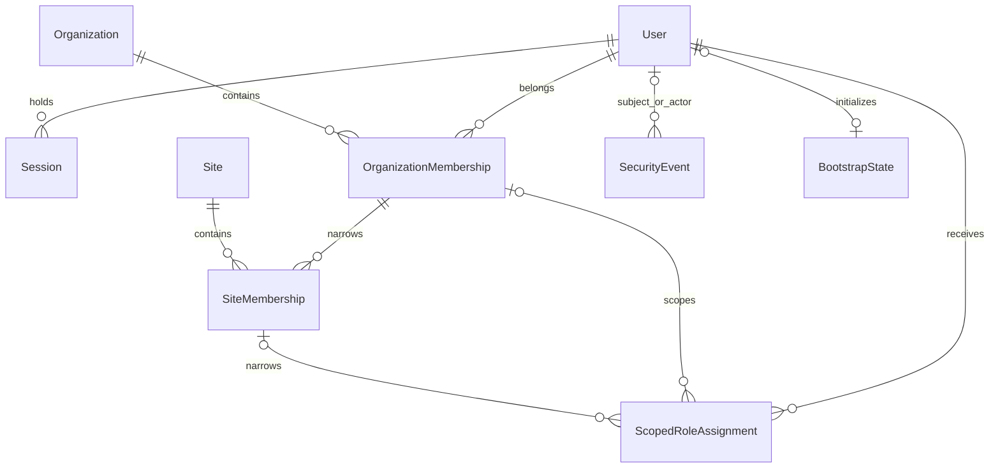

# AUTH-01 proposed physical model

A1 mapping/migration IMPLEMENTED under explicit user authorization and verified through user-executed evidence: all 13 A1 SQL tests passed, and native interactive initialization returned `Auth.Initialized` with exit code 0 after hidden password entry. This is not agent-executed evidence. Database cleanup after the interactive initialization is unreported. SQL Server, UTC datetime2(7) instants, long Identity keys; no Domain references to Identity/EF. The additive `20261108150853_IdentityBootstrapBaseline` owns ten auth tables with separate auth migration history and only a Pending singleton seed. Existing business tables/migrations are excluded and unchanged. [Decisions](decisions.md) owns policy; this document owns columns/constraints. No live database migration was performed by the agent.

A1 uses the framework user-only store with explicitly selected supported Identity schema Version1 and explicit approved column lengths, retaining package version 10.0.14. It does not create passkey/role tables or enable those features. UserManager, standard normalizer/password validators and built-in hasher are used; a narrow extra validator caps passwords at 128 characters. Shared-connection serializable bootstrap transaction spans the Identity context and existing attributed business/audit save, with a singleton update/hold lock. Security events identify the real host operator separately from the allocated application subject. First role is always OrganizationAdministrator at the created organization; no deployment assignment is seeded or accepted by the command.

Routine implementation details: mutable membership/assignment timestamps/actor IDs and rowversions are EF shadow metadata. Account profile rowversion complements the framework ConcurrencyStamp. Auth context refuses deletion, audit edits, scope/username replacement and edits to an already Completed state. Database role ForgeFlowAuthRuntime has the listed runtime object permissions and explicit write denials on setup/membership/grants/history; no SQL login/user or role member is provisioned by migration. The host initializer separately requires dbo/db_owner and rejects connections belonging to runtime roles. This checks a SQL provisioning capability, not the operator's Windows name. Down refuses any account/access/session/security data or Completed marker before dropping auth objects and leaves business objects untouched. SQL proof remains pending.

Use a user-only IdentityUserContext with the framework EF user store. An operation-scoped auth context owns schema `auth`; Organization/Site remain owned by their existing migration context. Map external Organization/Site principal keys with ExcludeFromMigrations for membership FKs; never recreate or independently migrate those tables. Bootstrap may share connection/transaction across these contexts through the narrow coordinator. Separate auth migration history (`auth.__EFMigrationsHistory`) avoids competing migration ownership.

## Framework account tables

Proposed physical names: auth.User, UserClaim, UserLogin, UserToken. Standard user-store support tables do not enable external login, claim-driven permissions, token APIs or role administration. No Identity Role/UserRole/RoleClaim tables are needed for this user-only store; fixed role definitions/permissions are immutable application policy, not user-editable rows. If the selected framework store requires a different mapped support shape, reconcile its model before migration; do not silently add full role features.

| User column | SQL type/nullability | Constraints |
|---|---|---|
| Id | bigint IDENTITY, NOT NULL | PK, positive immutable actor ID |
| UserName / NormalizedUserName | nvarchar(128), NOT NULL | Framework invariant normalization; unique unfiltered normalized-name index; permitted ASCII grammar from decisions; no name reuse/hard delete |
| Email / NormalizedEmail | nvarchar(256), NULL | Optional; nonunique normalized-email index; never a grant/recovery proof |
| EmailConfirmed / PhoneNumberConfirmed / TwoFactorEnabled / LockoutEnabled | bit, NOT NULL | Explicit framework flags; two-factor/phone flows not exposed |
| PhoneNumber | nvarchar(64), NULL | Framework field, unused by this scope |
| PasswordHash | nvarchar(max), NOT NULL | Framework hash only; no local account without password in this scope |
| SecurityStamp / ConcurrencyStamp | nvarchar(256), NOT NULL | Framework-managed invalidation/optimistic update; never emitted to logs |
| AccessFailedCount | int, NOT NULL | CHECK >= 0; Identity lockout workflow |
| LockoutEnd | datetimeoffset(7), NULL | Framework-compatible lockout field; written with UTC offset 0 |
| IsActive | bit, NOT NULL | Denied account cannot sign in/use an existing session |
| PreferredCulture | varchar(5), NULL | CHECK null or binary-exact fa-IR/en-US, no padded variants |
| CreatedAtUtc / UpdatedAtUtc | datetime2(7), NOT NULL / NULL | Trusted clock; updated >= created when set |
| RowVersion | rowversion, NOT NULL | Additional profile/eligibility concurrency token; preserve framework ConcurrencyStamp semantics |

Support tables: UserClaim has Id int IDENTITY PK, UserId bigint NOT NULL FK, ClaimType nvarchar(256) NULL, ClaimValue nvarchar(max) NULL and index UserId. UserLogin has LoginProvider/ProviderKey nvarchar(128) NOT NULL composite PK, ProviderDisplayName nvarchar(256) NULL, UserId bigint NOT NULL FK/index. UserToken has UserId bigint, LoginProvider/Name nvarchar(128) NOT NULL composite PK, Value nvarchar(max) NULL. All FKs to User are NO ACTION. No account deletion use case; no seeded credentials. Claims are not a source of scoped roles even if support rows exist. Password reset uses Identity's protected token provider in-process, not plaintext tokens in UserToken.

Name normalization uses Identity's invariant normalizer after the documented ASCII validation; NormalizedUserName uses Latin1_General_100_BIN2 and the unique index includes all active/inactive accounts. SQL length/grammar/padding checks constrain stored names and canonical uppercase normalized values; the server validates the original input before any SQL conversion. Do not use database-default case/accent rules as an authorization or uniqueness policy.

## Membership and fixed-role assignment

Shared metadata for mutable access rows: IsActive bit NOT NULL, CreatedAtUtc datetime2(7) NOT NULL, CreatedByActorId bigint NOT NULL positive, UpdatedAtUtc datetime2(7) NULL paired with UpdatedByActorId bigint NULL positive, RowVersion rowversion NOT NULL. No cascades or hard deletion. Immutable keys/scopes; revocation sets inactive and records an event, reactivation requires an explicit future authorized action. Metadata alone is not audit history.

| Table | Keys / scope | Additional constraints/indexes |
|---|---|---|
| OrganizationMembership | UserId bigint + OrganizationId bigint, NOT NULL composite PK | FK User and Organization NO ACTION; index (OrganizationId, IsActive, UserId) |
| SiteMembership | UserId bigint + OrganizationId bigint + SiteId bigint, NOT NULL composite PK | Composite FK (UserId, OrganizationId) -> OrganizationMembership and (OrganizationId, SiteId) -> existing Site owner key, NO ACTION; index (OrganizationId, SiteId, IsActive, UserId) |
| ScopedRoleAssignment | Id bigint IDENTITY PK; UserId bigint NOT NULL; RoleId tinyint NOT NULL; ScopeKind tinyint NOT NULL; OrganizationId bigint NULL; SiteId bigint NULL | FK User; composite optional FKs to OrganizationMembership and SiteMembership, all NO ACTION; metadata above |

Code-owned role IDs: 1=OrganizationAdministrator at ScopeKind 1=Organization; 2=SiteOperator at 2=Site; 3=DeploymentProvisioner at 0=Platform. CHECK permits exactly these role/scope pairs. Platform requires both owner IDs null; Organization requires OrganizationId nonnull/SiteId null; Site requires both nonnull. These checks make partially null membership FKs valid only for the correct scope. The Site membership FK also proves the Site is in the Organization. Active parent membership is a current query invariant, not something an FK proves.

Unique indexes reserve assignments across inactive rows: (UserId, RoleId) WHERE ScopeKind=0; (UserId, RoleId, OrganizationId) WHERE ScopeKind=1; (UserId, RoleId, OrganizationId, SiteId) WHERE ScopeKind=2. Index (UserId, IsActive, ScopeKind, OrganizationId, SiteId) supports exact authorization lookup. No wildcard/null-as-all scope, direct permission table or permission overrides. No table of editable role permissions. Default bootstrap inserts only actual membership/role assignments, never allow-all policies.

## Session

A3 uses this existing table without schema changes. Issuance/revocation and required events use one serializable operation transaction and the same account lock as recovery. Current account/session/stamp checks are performed for HTTP cookies, circuit revalidation and each protected use case. Real SQL/HTTP acceptance is DEFERRED; offline settings/claims tests are not SQL proof.

| Column | Type/nullability | Meaning |
|---|---|---|
| Id | uniqueidentifier NOT NULL PK | Server-created random session reference; not a bearer credential alone |
| UserId | bigint NOT NULL | FK User NO ACTION; index (UserId, RevokedAtUtc, ExpiresAtUtc) |
| SecurityStampSnapshot | nvarchar(256) NOT NULL | Compare against current User and protected ticket; not logged |
| IssuedAtUtc / ExpiresAtUtc | datetime2(7) NOT NULL | CHECK expires > issued; proposed fixed eight-hour lifetime |
| RevokedAtUtc | datetime2(7) NULL | Null means not explicitly revoked; expiry still checked |
| RevokeReason | varchar(32) NULL | Paired with revoked time; finite Logout/PasswordReset/AccountDisabled/AccountLocked/StampChanged reason set |
| RowVersion | rowversion NOT NULL | Concurrency on revocation; repeated logout idempotent |

No refresh-token table, sliding-session mechanism, persistent remember-me or credential in browser storage. Session GUID is accepted only from the protected ticket/server circuit identity and must match UserId. DB outage never validates it by trusting a stale ticket. Session-state changes and required events share the auth transaction. A successful logout/revocation must remain effective when old cookies/circuits are replayed.

## BootstrapState and security history

BootstrapState: Id tinyint PK CHECK=1; State tinyint NOT NULL (0 Pending/1 Completed); OperationId uniqueidentifier NULL; CompletedAtUtc datetime2(7) NULL; FirstUserId bigint NULL FK User; OrganizationId bigint NULL FK Organization; SiteId bigint NULL with composite owner FK Site; HostOperatorReference nvarchar(256) NULL; RowVersion rowversion NOT NULL. CHECK Pending => all completion fields null; Completed => all nonnull. Filtered unique OperationId when nonnull. Migration inserts only the empty Pending singleton, not an account. Serializable/UPDLOCK locking serializes initialization. Application SQL identity cannot complete/reset this record. Completed is irreversible through the tool; no HTTP re-enable switch.

SecurityEvent: Id bigint IDENTITY PK; EventCode varchar(64) NOT NULL (finite events below); OccurredAtUtc datetime2(7) NOT NULL; CorrelationId uniqueidentifier NOT NULL; ActorKind tinyint NOT NULL (0 Anonymous/1 User/2 HostOperator); ActorUserId bigint NULL FK User; SubjectUserId bigint NULL FK User; SessionId uniqueidentifier NULL FK Session; HostOperatorReference nvarchar(256) NULL; OrganizationId bigint NULL FK Organization; SiteId bigint NULL with composite owner FK Site; Outcome tinyint NOT NULL (Success/Denied/Failure); DataJson nvarchar(2000) NOT NULL CHECK ISJSON=1. FKs all NO ACTION. CHECK actor shape: Anonymous has neither user nor host; User has user/non-host; HostOperator has host/non-user. Scope permits no site without organization; invalid/guessed scopes are omitted from denial events, not confirmed by lookup. Indexes (OccurredAtUtc, Id), (SubjectUserId, OccurredAtUtc, Id), (CorrelationId), (OrganizationId, OccurredAtUtc, Id). Append-only; no rowversion needed.

Finite event set: BootstrapCompleted, AccountCreated, SignInFailed, AccountLocked, SessionIssued, SessionRevoked, AccessDenied, PasswordResetCompleted, AccountEligibilityChanged, MembershipChanged, ScopedRoleChanged, CulturePreferenceChanged. Event writer enforces a small per-event parameter allowlist; DataJson never receives an arbitrary request/claims object. Account/security changes include safe before/after active flags or fixed role/scope identifiers; profile event includes supported culture codes. No password/hash/stamp/reset token/cookie/raw attempted username/full IP/request payload. Login failures with unknown identity do not create a fake user or expose it in responses.

Host-operator recovery uses ActorKind=HostOperator, actual subject UserId and verified operator reference; it does not impersonate the account owner. Bootstrap additionally puts the real newly allocated first-user ID into OrganizationChange ActorId as the controlled-bootstrap subject/actor convention, with matching host-attributed event/correlation documenting who performed provisioning. Existing OrganizationChange remains unchanged and logically refers to stable account IDs; do not add a speculative cross-context Identity FK to Domain/business audit.

Runtime SQL principal: minimum user/session read/update/insert needed by the fixed HTTP/Identity workflows; read-only membership/role assignment access in this minimum slice; INSERT/SELECT only on SecurityEvent with explicit UPDATE/DELETE denial; no DELETE on accounts/sessions/memberships/assignments; no BootstrapState mutation. Recovery/bootstrap uses separately authorized provisioning credentials, never granted to the web process. Audit business-table role remains as implemented. No login/user/host grant is provisioned by this design. Existing DB compatibility, migrations, least privileges and backup/rollback preservation must be verified before execution; a populated downgrade may not delete Identity/security history.
